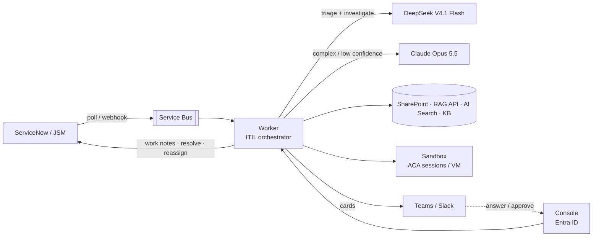
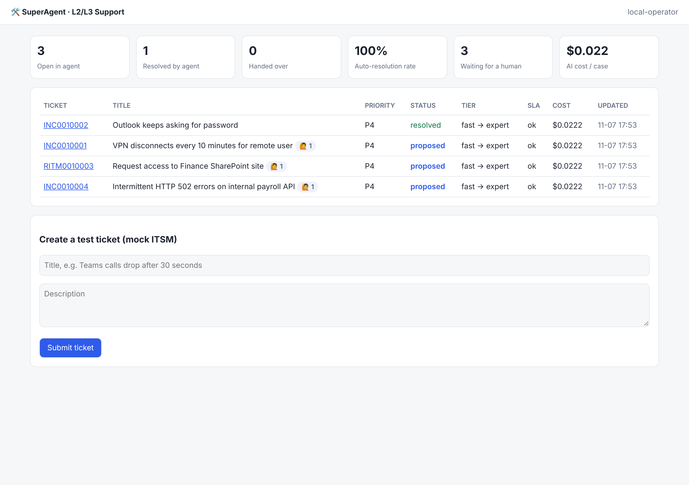

# SuperAgent: autonomous ITIL L2/L3 support agent on Azure

SuperAgent picks up tickets from your ITSM tool and works them like a senior 2nd/3rd-line engineer:

- It **triages** each ticket with ITIL (type, impact × urgency → priority, SLA).
- It **investigates** with your knowledge sources: SharePoint, Confluence, past Jira issues, your RAG API, your docs in
  Azure AI Search, ITSM KB articles and similar resolved tickets, plus any read-only tools you expose through MCP.
- It **reproduces and tests** in a secure sandbox (Azure Container Apps dynamic sessions or an ephemeral VM), including
  a sandbox running **your product**, where it can open the UI with a headless browser and read the logs.
- It **resolves** the ticket, or **hands it over** to a human team with a proper handover note.
- It **asks people for help** when needed and posts its progress to Teams/Slack.

It is cheap by default. A fast, low-cost model does most of the work. **Claude Opus 5.5** is called only for
complex or failed cases, as a second opinion before any human is involved. Both can run on Microsoft Foundry in
your subscription with the managed identity (no API keys), or through OpenRouter and the Claude API.





## Documentation

| Doc | What it covers |
|-----|----------------|
| [docs/PLAN.md](docs/PLAN.md) | Design and implementation plan (start here) |
| [docs/architecture.md](docs/architecture.md) | Components, data flow, state model, scaling |
| [docs/itil-processes.md](docs/itil-processes.md) | How each ITIL 4 practice is implemented |
| [docs/model-routing.md](docs/model-routing.md) | Fast/expert tiers, escalation rules, budgets, costs |
| [docs/deployment-guide.md](docs/deployment-guide.md) | **Step-by-step deployment on Azure** |
| [docs/configuration.md](docs/configuration.md) | Every setting and policy knob |
| [docs/connectors.md](docs/connectors.md) | ServiceNow, Jira SM, SharePoint, RAG, Teams, and adding your own |
| [docs/security.md](docs/security.md) | Threat model, sandbox isolation, prompt-injection defences |
| [docs/operations-runbook.md](docs/operations-runbook.md) | Day-2 operations, monitoring, troubleshooting |
| [docs/business-case.md](docs/business-case.md) | Value, KPIs, rollout phases (for stakeholders) |
| [docs/azure-mcp-setup.md](docs/azure-mcp-setup.md) | Connecting the Azure MCP server for AI-assisted ops |

## Quick start (local, 2 minutes, no keys needed)

```bash
make install
```

```bash
make demo
```

Open http://localhost:8000. The mock ITSM is seeded with sample tickets, and fake models show the whole flow:
triage → fast tier → escalation → expert → proposal → your approval.

With real models:

```bash
cp .env.example .env
```

Then set `SA_FAST_API_KEY` (OpenRouter) and `SA_EXPERT_API_KEY` (Anthropic) in `.env`, and run:

```bash
make run
```

In a second terminal:

```bash
./scripts/smoke-test.sh http://localhost:8000
```

## Deploy to Azure

```bash
az login
```

```bash
azd config set auth.useAzCliAuth true
```

```bash
azd env new superagent-dev
```

```bash
azd env set AZURE_LOCATION swedencentral
```

```bash
azd env set SA_ENABLE_FOUNDRY true
```

```bash
azd env set SA_ENABLE_SEARCH true
```

```bash
azd env set SA_CONSOLE_API_KEY "$(openssl rand -hex 24)"
```

```bash
azd up
```

This creates Container Apps (api + worker), Microsoft Foundry with both model deployments, Service Bus, Cosmos DB,
Key Vault, App Insights, ACR, Azure AI Search (Free tier) and a sandbox session pool, all wired with a managed
identity. It starts in **demo mode** (mock ITSM, with a demo product ticket). Then add the product sandbox
(`scripts/build-product-image.*` + `azd provision`) and load your docs (`scripts/ingest-docs.py`). To connect
ServiceNow, Teams, Confluence, Jira, SharePoint and the rest, follow [docs/deployment-guide.md](docs/deployment-guide.md).

## Repository layout

```
src/superagent/     application code (orchestrator, router, connectors, sandbox, API)
config/agent.yaml   behaviour policy: thresholds, ITIL rules, budgets, prices
infra/              Bicep (subscription-scope main + modules)
sandbox/            sandbox images: troubleshooting tools, product sandbox (demo product + browser), VM setup
samples/knowledge/  demo product docs for scripts/ingest-docs.py
scripts/            deploy, smoke test, Graph permissions, search index + doc ingest, product image build
tests/              unit + end-to-end tests (pytest)
docs/               documentation
```

## Status

v1. All components are implemented and covered by tests (`make test`). The connectors are built against the
public ServiceNow, Jira, Graph, Azure and model-provider APIs. Validate them against your own instance in
Phase 0 (shadow mode, the default: the agent proposes and humans approve).
