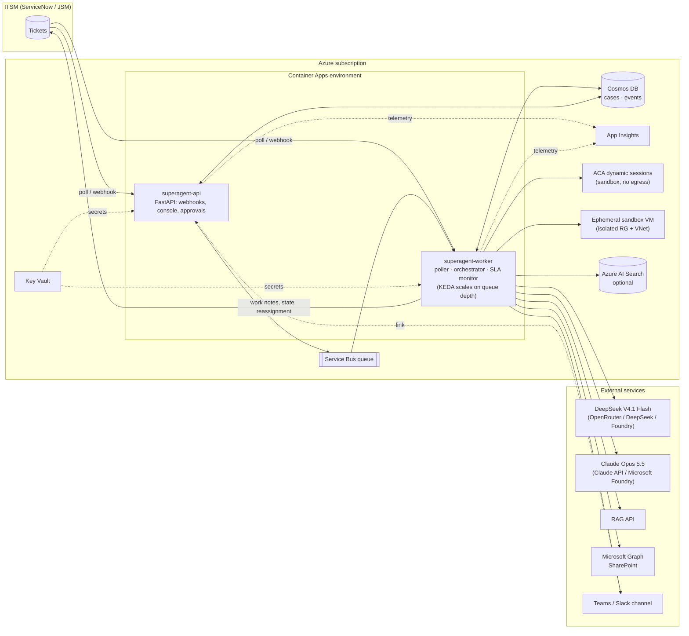
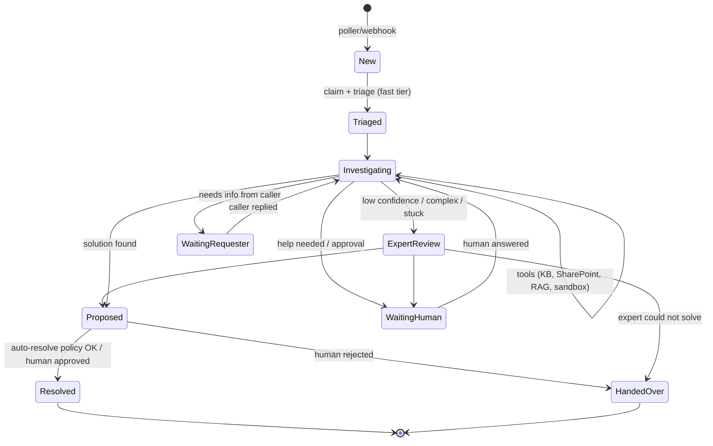

# SuperAgent: Design & Implementation Plan

> An autonomous L2/L3 IT support agent that follows ITIL 4: it picks up tickets, investigates
> them against enterprise knowledge, reproduces issues in a secure sandbox, resolves or hands
> over cleanly to humans, and reports what it does in a chat channel.
> It runs on Azure and is built to be deployed with one command (`azd up`).

Status: **v1 implemented in this repository.** This document records the design decisions;
the other files in `docs/` go deeper on each area.

---

## 1. Goals and non-goals

### Goals
| # | Goal | How we meet it |
|---|------|----------------|
| G1 | Take tickets from the ITSM tool and manage their full lifecycle | ITSM connector (ServiceNow, Jira Service Management, Mock). The agent claims, works, updates, resolves or reassigns tickets |
| G2 | Follow ITSM/ITIL practice | ITIL priority matrix (impact × urgency), SLA tracking, work notes vs customer comments, proper states and resolution codes, Major Incident detection, problem-record suggestions, no production changes without a Change (RFC) |
| G3 | Use several knowledge sources | Pluggable knowledge connectors: SharePoint (Microsoft Graph search), an external RAG API, Azure AI Search, ITSM KB articles and similar resolved tickets |
| G4 | Keep cost low but still handle hard cases | Model router: a cheap **fast tier** (DeepSeek V4.1 Flash) does most of the work. The **expert tier** (Claude Opus 5.5) is called only for complex or failed cases, before a human is involved |
| G5 | Ask for help, and keep humans informed | `request_human_help` tool, approvals, a Teams/Slack channel with Adaptive Card updates, and a web console for answering or approving |
| G6 | Reproduce and troubleshoot safely | Sandbox tool: Azure Container Apps **dynamic sessions** (Hyper-V isolated, no egress) by default, or an **ephemeral Azure VM** in an isolated sandbox resource group/VNet for Windows or full-OS cases. All commands pass a policy engine and are audited |
| G7 | Simple deployment on Azure | Bicep + Azure Developer CLI: `azd up` provisions everything with managed identity and Key Vault. A plain `az` script is also provided |
| G8 | Foundation for 2nd/3rd line | Clean extension points (connectors, tools, policies, prompts), an audit trail, and KPIs |

### Non-goals (v1)
- No changes to production systems. The agent may **draft** a Change Request (RFC) for humans/CAB.
- No end-user L1 chatbot (this agent works *tickets*; a self-service bot can feed the same queue later).
- No fine-tuning; knowledge comes from retrieval at run time.

---

## 2. Architecture



**Two containers, one image.**
- `superagent-api` takes ITSM webhooks and serves the operator console (case list, timeline, answers to
  help requests, approvals) and health/metrics endpoints.
- `superagent-worker` polls the ITSM queue(s), consumes the Service Bus queue, runs the orchestrator
  and runs the SLA monitor. KEDA scales it on queue depth.

**State** lives in Cosmos DB (serverless). The *case* is the agent's own record of a ticket, with an
append-only *event* timeline for the audit trail.
**Identity:** one user-assigned managed identity has access to Key Vault, Cosmos, Service Bus, ACR,
the session pool and (optionally) the sandbox resource group. No connection strings in code.

Every dependency sits behind an interface with an in-memory or local implementation. The whole agent
therefore runs on a laptop (`make demo`) with a mock ITSM, a Docker sandbox and real or fake LLMs.

---

## 3. Ticket lifecycle (orchestrator)

The orchestrator is **deterministic code** and owns the ITIL process. LLMs are used only for
triage and investigation, so process compliance does not depend on the model behaving.



1. **Intake:** the poller (or a ServiceNow Business Rule / JSM automation webhook) finds tickets
   in the agent's assignment group and enqueues `process_ticket`. Duplicates are ignored (the case id is the ticket id).
2. **Claim:** the worker takes a lease on the case (optimistic concurrency), assigns the ticket to the agent's
   service account, sets **In Progress**, and writes the work note *"SuperAgent acknowledged…"*.
3. **Triage:** one cheap structured call. Output: ticket type (incident / service request / problem / change-related),
   category, impact, urgency, complexity 1–5, Major Incident and security flags, a short summary and search keywords.
   **Priority is computed in code** from the ITIL matrix, never taken from the model. A security-related ticket
   goes straight to the security team. A suspected Major Incident pages humans immediately and investigation continues alongside.
4. **Investigation:** a tool-using agent loop on the selected tier (see §4). The model records findings in a structured
   **case file** and ends by calling `submit_outcome`.
5. **Decision (code):**
   - `resolved` and confidence ≥ `auto_resolve_threshold` and the auto-resolve policy allows it (type, priority, category) → **Resolve** with close code, close notes and the customer message.
   - `resolved` below the threshold → **Proposed** → approval card in chat → a human approves or rejects in the console.
   - `needs_requester_info` → customer comment with the questions → **On Hold – Awaiting Caller** (SLA paused, per ITIL).
   - `needs_human` → help request in chat → WaitingHuman, resumed with the human's answer.
   - `escalate_to_expert` / low confidence / step budget exhausted → **expert tier**, if budget allows.
   - The expert also fails → **Handover**: reassign to the L3 group with an ITIL-style handover note
     (symptoms, impact, timeline, what was checked, evidence, hypotheses, recommended next steps).
6. **Continual improvement:** resolved cases are written back as KEDB candidates (optional, to Azure AI Search).
   When N similar incidents appear in a window, the agent proposes a **Problem record**.

---

## 4. Model routing (cost-aware)

| Tier | Default model | Provider options | Used for |
|------|---------------|------------------|----------|
| fast | `deepseek/deepseek-v4.1-flash` | OpenRouter (default), DeepSeek API, Azure AI Foundry (OpenAI-compatible) | triage, most investigations |
| expert | `claude-opus-5-5` | Claude API (default) or **Claude in Microsoft Foundry** (keeps billing in Azure) | complex, P1/Major or failed cases |

The router decides:
- **Start on expert** when complexity ≥ `expert_direct_complexity` (default 5) or (P1 and `p1_expert_first`).
- **Escalate fast → expert** when the outcome is `escalate_to_expert`/`cannot_resolve`, confidence < `min_confidence`,
  the step limit is reached, or the model ended without a valid outcome.
- **Budget guardrails:** a per-ticket USD cap and a daily expert-tier USD cap. When the cap is hit, the ticket goes to a human, not to more model spend.
- **Fresh context on escalation:** the expert gets the *case file* (triage, findings, evidence, the fast tier's
  conclusion and why it stopped), not the raw transcript. This is cheaper and gives an independent second opinion.
- Expert-tier calls use adaptive thinking with `effort` (default `high`), prompt caching, and on the Claude API
  server-side refusal fallbacks. A refusal is treated as "needs a human".

Every call records tokens and cost per tier on the case. The cost shows on the console and is exported as a metric.

---

## 5. Tools available to the agent

| Tool | Side effects | Notes |
|------|--------------|-------|
| `search_knowledge(query, sources?)` | none | Fan-out to the enabled sources; results are merged, deduplicated and cited |
| `get_ticket_details(ticket_id?)` | none | Full ticket with comments and work notes |
| `find_similar_tickets(query)` | none | Resolved tickets from the ITSM tool |
| `sandbox_exec(command, purpose, target, network)` | sandbox only | Policy-checked. `network` other than `none` needs approval. Output truncated and redacted |
| `record_finding(kind, text, evidence?)` | case file | kind ∈ symptom, evidence, hypothesis, ruled_out, action |
| `add_work_note(text)` | ITSM (internal) | Progress note, visible to IT staff only |
| `request_human_help(question, urgency, blocking)` | chat | `blocking=true` pauses the case until a person answers |
| `draft_change_request(...)` | case file | Saved as a draft RFC for humans; never executed |
| `submit_outcome(...)` | ends the loop | Strict schema, validated in code |

Customer-facing text is **never** posted directly by the model. It goes into `submit_outcome.customer_message`
and the orchestrator posts it after the policy and redaction checks.

---

## 6. Sandbox design

- **Default: ACA dynamic sessions.** Each case gets its own session (`identifier = case id`), runs in a Hyper-V
  isolated container with **egress disabled**, and is destroyed after the cooldown. The built-in Python pool needs
  no image build. An optional custom-container pool with troubleshooting tools is provided (`sandbox/`).
- **Ephemeral VM** for Windows or full-OS reproductions. It is created in a dedicated `rg-<env>-sandbox` resource group, in a VNet
  with an NSG that denies Internet egress. It has no public IP, commands run via VM Run Command, and it is auto-deleted on case close or after a TTL.
  The managed identity has VM/Network Contributor **only on that resource group**.
- **Local Docker** (`--network none --read-only --cap-drop ALL --memory 512m --pids-limit 128`) for development.
- **Policy engine:** a denylist (destructive commands, credential access, fork bombs, crypto-mining, reverse shells),
  a max runtime, a max output size, secret redaction, network-mode approvals, and a full audit log of each command and result.

The sandbox never holds production credentials. It is for reproducing and testing hypotheses, not for changing production.

---

## 7. Human-in-the-loop & chat

- **Channel:** Microsoft Teams (Workflows webhook posting Adaptive Cards), Slack (incoming webhook) or console/log only.
- **Updates posted:** case started (with triage and priority), escalated to expert, help needed, approval needed,
  resolved, handed over, SLA at risk or breached, Major Incident, and a daily digest (volume, auto-resolution rate, cost).
- **Responding:** each card has a button to the console (`/cases/{id}`), where a person answers the help request
  or approves or rejects a proposal. The console is protected by **Entra ID** (Container Apps built-in auth) in Azure,
  or by an API key locally.

---

## 8. Security

- Managed identity everywhere; secrets in Key Vault, referenced by Container Apps.
- Least privilege: the ITSM service account can only update tickets in the agent's groups; the sandbox has its own RG.
- **Prompt-injection defence:** ticket and knowledge content is wrapped and marked as untrusted data. Tools with side
  effects are policy-gated. Production-changing actions do not exist as tools. Customer messages pass a redaction filter.
- Redaction of secrets/tokens in tool output and notes before they leave the worker.
- Full audit trail (Cosmos events + App Insights). Every model call, tool call and ITSM write is logged with the case id.
- Data residency: both tiers can run inside Azure (Foundry), for organisations that require it.

---

## 9. Repository layout

```
azure.yaml                 azd definition (api + worker services)
Dockerfile                 agent image
infra/                     Bicep (main.bicep + modules)
sandbox/                   optional custom sandbox image
config/agent.yaml          policies, thresholds, groups, prices
src/superagent/
  config.py  models.py  itil.py  container.py  worker.py  observability.py
  llm/        base, openai_compat (DeepSeek), anthropic_provider (Opus), router, fake
  itsm/       base, servicenow, jira_sm, mock
  knowledge/  base, sharepoint, rag_api, azure_search, itsm_kb
  sandbox/    base, policy, aca_sessions, azure_vm, docker_local, mock
  chat/       base, teams, slack, console
  store/      base, memory, sqlite, cosmos
  queue/      base, memory, servicebus
  agent/      prompts, tools, triage, investigator, orchestrator, handover
  api/        FastAPI app + console templates
tests/                     unit + end-to-end (mock everything)
scripts/                   deploy, Graph permissions, demo seeding, smoke test
docs/                      architecture, ITIL, deployment, config, security, routing, connectors, runbook, business case
```

---

## 10. Delivery phases (rollout in your organisation)

| Phase | Scope | Exit criteria |
|-------|-------|---------------|
| 0 – Shadow | The agent works tickets but **only writes work notes / proposals**; `auto_resolve: false` | ≥ 70 % of proposals rated correct by L2 |
| 1 – Assist | Auto-resolve allowed for low-risk categories (P4/P3, listed categories) | Reopen rate below the human baseline |
| 2 – Autonomous L2 | Most categories; expert tier on; sandbox repros | KPI targets met for 4 weeks |
| 3 – L3 foundation | Problem management, change drafting, KEDB loop, more connectors | — |

KPIs: auto-resolution rate, MTTR, first-time-fix, reopen rate, SLA compliance, escalation accuracy,
cost per ticket, and human hours saved. See `docs/business-case.md`.

---

## 11. Testing strategy

- Unit tests: ITIL matrix, policy engine, router decisions, connector mappings (HTTP mocked), redaction.
- End-to-end tests with a scripted fake LLM: resolve on fast tier; escalate to expert; hand over to human;
  wait for a human and resume; dangerous sandbox command blocked; budget cap respected.
- Live smoke test (`scripts/smoke-test.sh`): real models + mock ITSM + Docker or ACA sandbox, against a running deployment.
- Bicep compiled in CI (`az bicep build`), plus `ruff` and `pytest` in a GitHub Actions workflow.
