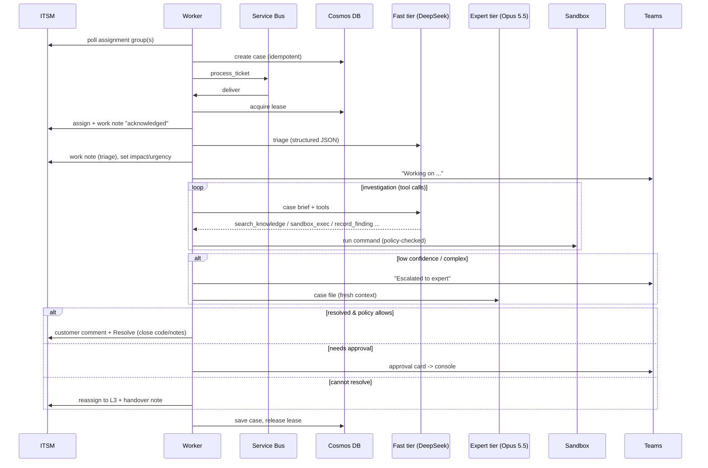

# Architecture

## Components

| Component | Azure service | Code | Responsibility |
|-----------|---------------|------|----------------|
| API / console | Container App `ca-<env>-api` (external ingress, Entra ID auth) | `api/app.py` | Webhooks, operator console, approvals, JSON API, metrics |
| Worker | Container App `ca-<env>-worker` (KEDA on Service Bus) | `worker.py` | ITSM poller, queue consumers, SLA monitor, digest, VM reaping |
| Orchestrator | in the worker | `agent/orchestrator.py` | ITIL lifecycle: claim, triage, investigate, decide, resolve or hand over |
| Model router | in the worker | `llm/router.py` | Picks fast/expert tier, enforces budgets |
| LLM providers | OpenRouter / DeepSeek / Foundry; Claude API / Foundry | `llm/openai_compat.py`, `llm/anthropic_provider.py` | Native tool loops per provider |
| Toolbox | in the worker | `agent/tools.py` | Knowledge search, sandbox, findings, help requests, RFC drafts, outcome |
| Case store | Cosmos DB serverless (`cases`, `events`) | `store/cosmos.py` | Case state (optimistic concurrency) + audit trail |
| Queue | Service Bus queue `tickets` (duplicate detection) | `queue/servicebus.py` | Decouples intake from processing; resume messages |
| Sandbox | ACA dynamic sessions pool (egress disabled); optional VM in `rg-<env>-sandbox` | `sandbox/*` | Isolated reproduction/testing |
| Secrets | Key Vault (RBAC) | Bicep | API keys, ITSM credentials, webhook URLs |
| Telemetry | Log Analytics + Application Insights | `observability.py` | Logs, traces, dependency calls |

## Request flow

## State model

A **case** (`models.Case`) is the agent's working record of a ticket. Its id is the ticket id.
- `status`: new → triaged → investigating → expert_review → (waiting_human | waiting_requester | proposed) → resolved | handed_over
- `triage`, `findings` (the case file), `sandbox_runs`, `help_requests`, `outcomes`, `change_drafts`
- `usage` per tier (tokens and USD), `tiers_used`, SLA due dates, lease fields

**Events** (`CaseEvent`) are append-only. Every model call outcome, tool call, routing decision, ITSM write and
human response is recorded. The console's timeline is this audit trail.

## Concurrency and reliability

- **Idempotent intake.** `create_if_absent` on the case id, plus Service Bus duplicate detection on `kind:ticket:reason`.
- **Leases.** A worker acquires a case with optimistic concurrency (Cosmos `_etag`) before processing it.
  A lease expires after 15 minutes, so a crashed worker never blocks a case forever.
- **Retries.** A failed message is abandoned and redelivered, up to 5 times before dead-lettering. After 3 failed
  attempts on a case the agent hands it over to humans with the error noted.
- **Resume.** Human answers and requester replies enqueue `resume_case`. If the case is busy, the resume is retried after 30 s.
- **Scaling.** KEDA scales the worker from 1 to 5 replicas on queue depth. One replica always runs, for the poller and the SLA monitor.

## Demo mode vs production mode

| | Demo (`itsmProvider=mock`) | Production (`servicenow`/`jira`) |
|---|---|---|
| Tickets | In-memory sample tickets + "create test ticket" form | Real ITSM |
| Worker | Runs inside the API container (single replica) | Separate worker app, KEDA-scaled |
| Queue | In-process | Service Bus |
| Store | Cosmos DB | Cosmos DB |

## Extending

Each integration sits behind a small abstract class: `ITSMConnector`, `KnowledgeSource`, `Sandbox`,
`ChatChannel`, `CaseStore`, `WorkQueue`, `LLMProvider`. Implement one, add it to `container.py`, and add a
setting. See [connectors.md](connectors.md).
