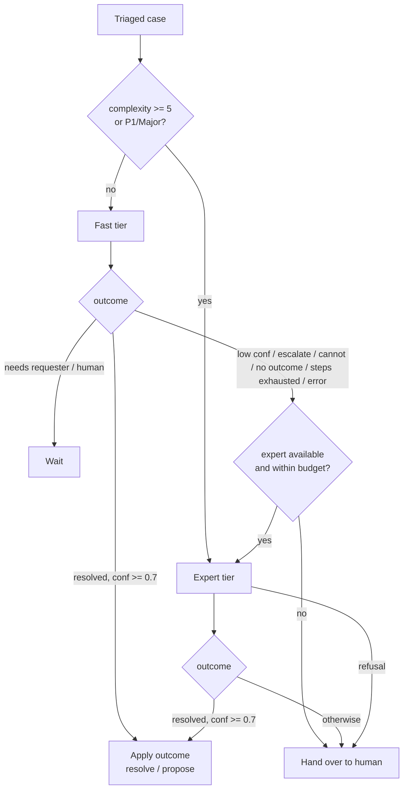

# Model routing, budgets and costs

## Tiers

| Tier | Default | Price (per 1M tokens, Nov 2026) | Typical use |
|------|---------|----------------------------------|-------------|
| fast | `deepseek/deepseek-v4.1-flash` via OpenRouter | ~$0.05–0.15 input / ~$0.6 output | Triage and roughly 80–90 % of investigations |
| expert | `claude-opus-5-5` via the Claude API or Microsoft Foundry | $4 input / $20 output | Complex, P1 or failed cases |

Prices change. Keep `prices:` in `config/agent.yaml` current, because the budgets are computed from them.

## Routing rules (`llm/router.py`)

- The **expert tier gets a fresh context**: the structured case file (triage, findings, sandbox results, the fast
  tier's conclusion). It does not get the raw transcript. This is cheaper, and it gives an independent second opinion.
- **Budgets.** `per_ticket_budget_usd` (default $3) and `daily_expert_budget_usd` (default $50). When a budget is
  reached, the case goes to a human instead of spending more. The daily spend is recomputed from the shared store every 5 minutes.
- **Step limits.** `fast_max_steps` 14, `expert_max_steps` 20 model turns per run.

## Expert-tier request settings (Claude Opus 5.5)

- Adaptive thinking (`thinking: {type: "adaptive"}`), with depth set by `output_config.effort`
  (`routing.expert_effort`, default `high`; use `xhigh` for very hard cases).
- No sampling parameters, no forced `tool_choice`, no prefill. Opus 5.5 rejects all of these.
- Prompt caching (`cache_control: ephemeral`) for the system prompt and tools.
- The full response content, including thinking blocks, is appended back on each turn.
- **Refusal fallback.** On the Claude API, server-side fallbacks are enabled (`fallbacks: "default"`, beta
  `server-side-fallback-2026-07-01`): if a safety classifier declines, the API re-runs the request on a fallback
  model. If the final `stop_reason` is still `refusal`, the case goes to a human.
  Turn this off with `routing.expert_server_side_fallback: false`. It is not used on Foundry.

## Provider options

| Need | Fast tier | Expert tier |
|------|-----------|-------------|
| Simplest, cheapest | OpenRouter (`SA_FAST_BASE_URL=https://openrouter.ai/api/v1`) | Claude API (`SA_EXPERT_PROVIDER=anthropic`) |
| Everything billed and hosted in Azure | DeepSeek deployment in Azure AI Foundry (OpenAI-compatible endpoint, `SA_FAST_BASE_URL=https://<resource>.services.ai.azure.com/openai/v1`) | Claude in Microsoft Foundry (`SA_EXPERT_PROVIDER=foundry`, `SA_FOUNDRY_RESOURCE=<name>`, managed identity, needs the *Cognitive Services User* role) |
| One key for both | OpenRouter | `SA_EXPERT_PROVIDER=openai_compat`, `SA_EXPERT_MODEL=anthropic/claude-opus-5.5` |
| DeepSeek direct | `SA_FAST_BASE_URL=https://api.deepseek.com`, `SA_FAST_MODEL=deepseek-chat` | — |

## Cost expectations (illustrative)

A typical fast-tier investigation is 6–10 turns of 4–15k input tokens: about **$0.005–0.02 per ticket**.
An expert-tier escalation is 5–15 turns: about **$0.30–1.50 per escalated ticket**.
With 15 % of tickets escalated, **1,000 tickets/month cost roughly $60–250** in model usage.
For comparison, an L2 engineer-hour typically costs $40–80. Measure your own numbers with `/api/metrics`.

## Tuning

- `min_confidence`: higher means more escalations (more expert spend, fewer wrong proposals).
- `expert_direct_complexity`: lower means more tickets start on the expert tier.
- `expert_effort`: `medium` is cheaper, `xhigh` is more thorough.
- Prompts can be overridden without code changes: drop `investigator_system.md`, `expert_addendum.md` or
  `triage_system.md` into `config/prompts/`.
